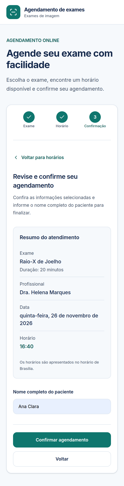
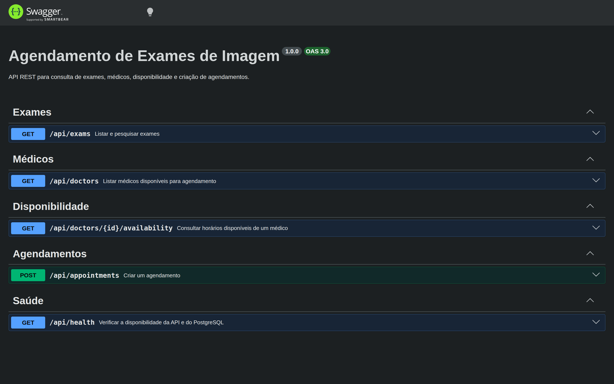

# Agendamento de Exames de Imagem

Aplicação full-stack desenvolvida para o desafio técnico da **A3Data**. Permite pesquisar exames de imagem, selecionar um médico, consultar horários disponíveis e confirmar agendamentos, respeitando os turnos de atendimento e impedindo reservas sobrepostas.

O fluxo principal está implementado no **backend NestJS** e no **frontend React**, com testes unitários, de integração HTTP e de ponta a ponta em navegador real.

## Visão da aplicação

### Desktop — seleção de médico, data e horário


### Mobile — revisão e confirmação

<table>
  <tr>
    <td align="center" valign="top" width="50%">
      
    </td>
    <td align="center" valign="top" width="50%">
      
    </td>
  </tr>
</table>

### Swagger — documentação interativa da API



A documentação interativa da API está disponível em
[`/api/docs`](http://localhost:3000/api/docs) com o backend em execução.

As capturas mostram a jornada de agendamento em diferentes tamanhos de tela.

## Tecnologias

| Camada                         | Tecnologias                                                                             |
| ------------------------------ | --------------------------------------------------------------------------------------- |
| Backend                        | Node.js 24, NestJS, TypeScript, TypeORM, OpenAPI/Swagger                                |
| Banco de dados                 | PostgreSQL 17                                                                           |
| Validação e datas              | Zod, Luxon                                                                              |
| Frontend                       | React, TypeScript, Vite, Tailwind CSS, TanStack Query, React Hook Form, React DayPicker |
| Testes do backend              | Vitest, Supertest                                                                       |
| Testes do frontend             | Vitest, React Testing Library, MSW, Playwright (Chromium), axe-core                     |
| Infraestrutura                 | Docker Compose, npm Workspaces, GitHub Actions                                          |
| Documentação e observabilidade | Swagger UI, coleção Postman/Insomnia, logs JSON e Request ID                            |

## Arquitetura e decisões técnicas

O projeto utiliza um **monorepo com npm Workspaces**, separando a API NestJS (`backend/`) da interface React (`frontend/`). Essa organização permite manter as duas aplicações e seus testes no mesmo repositório, com dependências e comandos de execução próprios.

### Backend

- **NestJS e TypeScript:** organização por módulos, injeção de dependências e separação entre controllers, services e regras de negócio.
- **PostgreSQL:** persistência relacional e garantias de integridade transacional. A _exclusion constraint_ GiST impede agendamentos sobrepostos para um mesmo médico, inclusive sob concorrência.
- **TypeORM:** mapeamento das entidades e evolução do schema por migrations, mantendo `synchronize: false`.
- **Zod:** validação dos dados recebidos pela API.
- **Luxon:** tratamento de instantes, datas e fuso horário da clínica.
- **OpenAPI/Swagger:** contratos HTTP derivados dos schemas Zod e complementados com respostas, descrições e exemplos.
- **Observabilidade básica:** logs HTTP estruturados em JSON, `X-Request-ID` por requisição e sanitização de exceções inesperadas.
- **Health check:** consulta `SELECT 1` ao PostgreSQL, com retorno `503` quando a verificação falha após a aplicação estar iniciada.

### Frontend

- **React, TypeScript e Vite:** aplicação de página única com inicialização rápida em desenvolvimento, sem necessidade de renderização no servidor para o fluxo solicitado.
- **TanStack Query:** consultas, cache, invalidação e atualização da disponibilidade.
- **React Hook Form e Zod:** gerenciamento e validação do formulário de confirmação.
- **Tailwind CSS:** estilização responsiva, com componentes e padrões visuais próprios do projeto.
- **React DayPicker:** seleção de datas considerando o fuso horário da clínica.

O fluxo é dividido em seleção de exame, escolha de médico/data/horário, revisão e confirmação, e apresentação do resultado. As diretrizes visuais e de acessibilidade estão descritas em [`docs/ux-ui-decisions.md`](docs/ux-ui-decisions.md).

### Premissas adotadas

- Todos os médicos podem realizar todos os exames fornecidos no desafio.
- Os turnos representam agendas semanais recorrentes; não foram fornecidas exceções específicas para férias, feriados ou afastamentos.
- Cada exame ocupa integralmente a duração informada no catálogo.
- Os horários candidatos são gerados a partir do **início de cada turno**, em intervalos iguais à duração do exame, sem ultrapassar o fim do expediente.
- O fuso horário da clínica é `America/Sao_Paulo`. Os instantes são transmitidos com indicação explícita de fuso e podem ser persistidos ou serializados em UTC.
- O horário de término é calculado exclusivamente no backend.
- O frontend utiliza o proxy `/api` do Vite durante o desenvolvimento; a API é executada separadamente.

## Funcionalidades

- Busca de exames por nome, com indicação da duração do procedimento.
- Listagem de médicos e consulta da disponibilidade por data e exame.
- Agendamento com nome do paciente, médico, exame e horário selecionado.
- Validação de expediente, duração, horários passados e conflitos de reserva.
- Proteção contra agendamentos simultâneos sobrepostos no PostgreSQL.
- Fluxo web responsivo em **português brasileiro**, com revisão e confirmação do agendamento.
- Limitação de requisições ao endpoint público de criação de agendamentos.
- Suporte a chaves de idempotência para recuperar reservas já confirmadas sem duplicá-las.
- Endpoint de saúde da API com verificação de conectividade do PostgreSQL.
- Documentação interativa Swagger e coleção de requisições Postman/Insomnia.
- Logs HTTP estruturados e identificação de requisições para diagnóstico.

## Estrutura do projeto

```text
a3data-medical-scheduling/
├── backend/                 # API REST, regras de negócio, migrations e seeds
├── frontend/                # Interface React e testes de navegador
├── challenge/               # Enunciado e arquivos originais do desafio
│   └── dados/
│       ├── exames.csv
│       └── medicos.md
├── docs/
│   ├── ux-ui-decisions.md   # Diretrizes e decisões de design
│   ├── postman/
│   │   └── medical-scheduling.postman_collection.json  # Coleção importável
│   └── screenshots/
│       ├── app-desktop-booking.png
│       ├── app-mobile-review.png
│       └── app-mobile-success.png
├── compose.yaml             # PostgreSQL de desenvolvimento e de testes
├── .env.example
├── .env.test.example
└── README.md
```

### Documentação complementar

As decisões sobre a jornada do paciente, o design system, as cores, a tipografia, a responsividade e a acessibilidade estão registradas em [Diretrizes de UX/UI](docs/ux-ui-decisions.md).

## Pré-requisitos

- **Node.js 24** e npm.
- **Docker** com Docker Compose.
- Git, para clonar e versionar o projeto.
- Chromium do Playwright, somente para executar os testes de navegador (instruções abaixo).

## Instalação e execução local

### 1. Clonar o repositório

No terminal, acesse o diretório em que deseja armazenar o projeto e execute:

```bash
git clone https://github.com/gabrielnunesBR/a3data-medical-scheduling.git
cd a3data-medical-scheduling
```

A partir daqui, execute os demais comandos **na raiz do repositório**, salvo indicação contrária.

### 2. Instalar as dependências

```bash
npm ci
```

### 3. Configurar as variáveis de ambiente

```bash
cp .env.example .env
```

Edite `.env` e defina uma senha local em `POSTGRES_PASSWORD`. Não versione arquivos com credenciais.

### 4. Iniciar o banco de desenvolvimento

```bash
docker compose up -d db
```

| Parâmetro       | Valor padrão          |
| --------------- | --------------------- |
| Host            | `127.0.0.1`           |
| Porta publicada | `5433`                |
| Banco           | `medical_scheduling`  |
| Usuário         | `medical_app`         |
| Senha           | Configurada em `.env` |

### 5. Aplicar as migrations

```bash
npm run migration:run --workspace=backend
```

A estrutura do PostgreSQL é controlada por migrations do TypeORM; a opção `synchronize` permanece desabilitada. Para verificar o histórico:

```bash
npm run migration:show --workspace=backend
```

### 6. Importar os dados de referência

```bash
npm run seed:exams --workspace=backend
npm run seed:doctors --workspace=backend
```

Os seeds importam **30 exames** de `challenge/dados/exames.csv`, preservando seus IDs, e **5 médicos com 36 turnos semanais**, conforme `challenge/dados/medicos.md`.

Ambos são idempotentes: podem ser executados novamente sem duplicar ou sobrescrever registros existentes. A importação dos médicos e turnos é transacional.

### 7. Iniciar backend e frontend

Em um terminal:

```bash
npm run dev:api
```

Em outro terminal:

```bash
npm run dev:web
```

| Serviço        | Endereço padrão         |
| -------------- | ----------------------- |
| API NestJS     | `http://localhost:3000` |
| Frontend React | `http://localhost:5173` |

Durante o desenvolvimento, o Vite encaminha as chamadas a `/api` para o backend por meio de seu proxy local.

### Compilação

```bash
npm run build
```

Para compilar separadamente:

```bash
npm run build --workspace=backend
npm run build --workspace=frontend
```

## API REST

| Método | Endpoint                                            | Finalidade                                      |
| ------ | --------------------------------------------------- | ----------------------------------------------- |
| `GET`  | `/api/exams?search=...`                             | Listar ou pesquisar exames pelo nome            |
| `GET`  | `/api/doctors`                                      | Listar médicos                                  |
| `GET`  | `/api/doctors/:id/availability?examId=...&date=...` | Consultar horários disponíveis                  |
| `POST` | `/api/appointments`                                 | Confirmar um agendamento                        |
| `GET`  | `/api/health`                                       | Verificar conectividade da API com o PostgreSQL |

### Swagger / OpenAPI

Com a API em execução, a documentação interativa e a especificação ficam disponíveis em:

- **Swagger UI:** `http://localhost:3000/api/docs`
- **OpenAPI JSON:** `http://localhost:3000/api/openapi.json`

Os schemas de entrada são derivados das validações Zod. O `Idempotency-Key` é opcional, e os exemplos de agendamento são ilustrativos: consulte a disponibilidade antes de executar um `POST`. A especificação é verificada por um teste E2E de contrato (`backend/test/openapi.e2e-spec.ts`).

### Coleção Postman / Insomnia

A coleção pronta para importação está em [`docs/postman/medical-scheduling.postman_collection.json`](docs/postman/medical-scheduling.postman_collection.json). Ela inclui os cinco endpoints, uma requisição adicional de busca de exames, variáveis reutilizáveis e verificações básicas de resposta.

Importe o JSON no Postman ou Insomnia, inicie a API local e consulte **Exames**, **Médicos** e **Disponibilidade** antes de executar **Criar agendamento**. No `POST`, preencha `startAt` com um horário ISO 8601 válido, conforme a disponibilidade retornada; o horário não é preenchido automaticamente pela consulta. O header `Idempotency-Key` é opcional e deve usar um novo UUID para cada nova operação. **Executar o POST grava uma reserva real no banco configurado.**

### Health check

```bash
curl -i "http://localhost:3000/api/health"
```

Com o PostgreSQL acessível, a API retorna `200 OK` e `{"status":"ok"}`. Se uma consulta ao banco falhar enquanto a API estiver em execução, retorna `503 Service Unavailable` com uma mensagem genérica e o header `X-Request-ID`. Como o TypeORM conecta durante o bootstrap, uma falha de banco antes da inicialização pode impedir que a aplicação suba; nesse caso não haverá endpoint disponível para responder.

### Buscar exames

```bash
curl "http://localhost:3000/api/exams?search=Resson%C3%A2ncia"
```

O parâmetro `search` é opcional. Sem ele, a API retorna o catálogo de exames. Os registros são apresentados em ordem alfabética pelo nome; os IDs originais são preservados. A busca é feita por nome, com correspondência sem diferenciar maiúsculas de minúsculas, mas sem garantir remoção de acentos.

### Listar médicos

```bash
curl "http://localhost:3000/api/doctors"
```

A resposta contém os identificadores dos médicos, necessários para consultar disponibilidade e criar agendamentos. Os médicos são listados em ordem alfabética por nome.

### Consultar disponibilidade

```bash
curl "http://localhost:3000/api/doctors/1/availability?examId=17&date=2030-01-07"
```

| Parâmetro | Local        | Descrição                                |
| --------- | ------------ | ---------------------------------------- |
| `id`      | URL          | Identificador inteiro positivo do médico |
| `examId`  | Query string | Identificador inteiro positivo do exame  |
| `date`    | Query string | Data no formato `YYYY-MM-DD`             |

O ID `1` é ilustrativo; consulte o ID real em `GET /api/doctors`.

Exemplo **ilustrativo** de resposta para um turno das 08h às 12h e um exame de 40 minutos, sem agendamentos existentes:

```json
["08:00", "08:40", "09:20", "10:00", "10:40", "11:20"]
```

A API retorna horários no formato `HH:mm`, considerando a duração do exame, os turnos do médico, os agendamentos existentes e o instante atual. Quando não há horários disponíveis, retorna `200 OK` com `[]`.

**Fuso horário da clínica:** `America/Sao_Paulo` (horário de Brasília). Os horários livres são exibidos em `HH:mm` no horário da clínica, em ordem cronológica; não são timestamps UTC.

### Criar agendamento

```bash
curl -i -X POST "http://localhost:3000/api/appointments" \
  -H "Content-Type: application/json" \
  -d '{
    "patientName": "João Silva",
    "examId": 17,
    "doctorId": 1,
    "startAt": "2030-01-07T09:20:00-03:00"
  }'
```

| Campo         | Descrição                                                 |
| ------------- | --------------------------------------------------------- |
| `patientName` | Nome do paciente, com até 160 caracteres                  |
| `examId`      | Identificador do exame                                    |
| `doctorId`    | Identificador do médico                                   |
| `startAt`     | Data e hora ISO 8601 com fuso explícito (`-03:00` ou `Z`) |

O horário de término (`endAt`) é calculado **no backend** a partir da duração cadastrada para o exame. Em caso de sucesso, a API retorna `201 Created`, incluindo o ID da reserva, os dados do agendamento e a data de criação. Os instantes são serializados em UTC (`Z`); por exemplo, `08:00-03:00` corresponde a `11:00Z` no mesmo dia.

**Importante:** o payload acima é ilustrativo. Antes de criar uma reserva, consulte os horários disponíveis para o médico, exame e data escolhidos. Uma data válida no formato ISO não garante um horário livre.

A requisição também aceita o header opcional `Idempotency-Key`, detalhado a seguir.

| Código HTTP                | Situação                                                                                          |
| -------------------------- | ------------------------------------------------------------------------------------------------- |
| `201 Created`              | Agendamento confirmado                                                                            |
| `400 Bad Request`          | Dados de entrada ou header `Idempotency-Key` inválidos                                            |
| `404 Not Found`            | Médico ou exame inexistente                                                                       |
| `409 Conflict`             | Horário ocupado, conflito com outra reserva ou reutilização indevida de uma chave de idempotência |
| `422 Unprocessable Entity` | Horário passado, fora do expediente ou fora da grade válida                                       |
| `429 Too Many Requests`    | Limite de tentativas de agendamento excedido                                                      |

### Idempotência na criação de agendamentos

O endpoint `POST /api/appointments` aceita o header **opcional** `Idempotency-Key`, contendo um UUID. A chave identifica uma operação de criação e permite recuperar o resultado de uma reserva já confirmada sem inserir outro registro.

Exemplo de requisição com idempotência:

```bash
curl -i -X POST "http://localhost:3000/api/appointments" \
  -H "Content-Type: application/json" \
  -H "Idempotency-Key: 550e8400-e29b-41d4-a716-446655440000" \
  -d '{
    "patientName": "João Silva",
    "examId": 17,
    "doctorId": 1,
    "startAt": "2030-01-07T09:20:00-03:00"
  }'
```

O UUID acima é **apenas ilustrativo**. Para cada nova operação de agendamento, utilize uma chave nova; para repetir a **mesma operação com os mesmos dados**, reutilize a chave original.

| Situação                        | Comportamento                                                             |
| ------------------------------- | ------------------------------------------------------------------------- |
| Chave nova e agendamento válido | Cria a reserva e retorna `201 Created`                                    |
| Mesma chave e mesmos dados      | Retorna `201 Created` com o **mesmo agendamento e ID**, sem nova inserção |
| Mesma chave e dados diferentes  | Retorna `409 Conflict` com o código `IDEMPOTENCY_KEY_REUSED`              |
| Chave ausente                   | Mantém o comportamento convencional de criação de agendamentos            |
| Chave com formato inválido      | Retorna `400 Bad Request`                                                 |

A chave é armazenada na coluna `appointments.idempotency_key` (UUID, aceita `NULL`), protegida por uma restrição `UNIQUE`. Para requisições com chave, a API utiliza **transação e advisory lock transacional do PostgreSQL** antes de consultar ou criar a reserva. Duas requisições simultâneas com a mesma chave são serializadas e podem receber o mesmo resultado.

A idempotência **não substitui** a proteção contra horários sobrepostos: requisições com chaves diferentes ainda estão sujeitas à validação de disponibilidade e à _exclusion constraint_ do PostgreSQL.

#### Integração com o frontend

O React utiliza `crypto.randomUUID()` para criar uma chave por operação. Enquanto a tela de confirmação permanecer montada:

- Tentativas com os mesmos dados reutilizam a mesma chave.
- Alterações no nome do paciente, exame, médico ou horário geram uma nova chave.
- Em uma falha de rede ou resposta de servidor inconclusiva, o paciente pode repetir manualmente a confirmação com a chave original.
- Não há repetição automática da requisição de criação.
- A chave é descartada após a confirmação bem-sucedida.

As chaves são mantidas **somente em memória**. Recarregar a página encerra a capacidade do cliente de reutilizar a chave anterior; não há persistência em armazenamento do navegador.

A chave identifica a operação, **não** é um mecanismo de autenticação ou autorização. O rate limiting continua contabilizando as requisições, inclusive as repetições com a mesma chave. A garantia de recuperação permanece enquanto o agendamento associado existir no banco.

## Regras de negócio e integridade

- Cada exame possui uma duração utilizada para gerar os horários possíveis.
- A grade é calculada **a partir do início de cada turno**, em incrementos iguais à duração do exame.
- O exame deve caber integralmente dentro do turno.
- Horários passados ou fora do expediente não podem ser reservados.
- Todos os médicos cadastrados podem realizar todos os exames do desafio.
- A disponibilidade é revalidada no momento da confirmação, pois pode mudar após a consulta.
- Dois agendamentos do **mesmo médico** não podem possuir intervalos sobrepostos.
- **Médicos diferentes** podem atender simultaneamente.
- Agendamentos consecutivos são permitidos, desde que não haja sobreposição.

### Concorrência no PostgreSQL

Além das validações da aplicação, a tabela `appointments` utiliza uma **exclusion constraint GiST**:

```sql
EXCLUDE USING GIST (
  doctor_id WITH =,
  tstzrange(start_at, end_at, '[)') WITH &&
)
```

Ela impede que duas requisições concorrentes confirmem horários conflitantes para o mesmo médico. O PostgreSQL retorna SQLSTATE `23P01` quando a restrição é violada, e a API converte o erro em `409 Conflict`. Um deadlock detectado durante a tentativa de reserva (`40P01`) também é tratado como `409 Conflict`, sem confirmar a operação. Nesse caso, o cliente deve consultar novamente a disponibilidade antes de tentar outra reserva; não há retry automático da transação.

A tabela também possui `CHECK (start_at < end_at)`, impedindo intervalos com duração nula ou negativa.

## Segurança e confiabilidade

### Logs estruturados, Request ID e exceções seguras

A API produz logs HTTP em JSON, com método, padrão de rota, status de resposta, duração e identificador `requestId`. O mesmo UUID gerado pelo servidor é devolvido no header `X-Request-ID`, inclusive em respostas HTTP de erro. IDs enviados pelo cliente não são utilizados como identificadores confiáveis.

```bash
curl -i "http://localhost:3000/api/health"
```

A instrumentação HTTP não registra o corpo das requisições, parâmetros de URL completos, headers de autenticação ou nomes dos pacientes. O filtro global preserva respostas de erro HTTP esperadas (como 400, 409 e 422) e, para exceções inesperadas, registra somente o `requestId` e uma categoria genérica; a resposta permanece `500 Internal server error`. Isso evita que SQL, parâmetros da consulta e stack traces dessas exceções sejam registrados pelo tratamento HTTP padrão.

Essa medida **não representa uma auditoria de todos os logs de dependências ou da inicialização da aplicação**. Em produção, seriam necessários controles adicionais de retenção, acesso e tratamento de dados pessoais.

### Cabeçalhos HTTP de segurança

A API utiliza os cabeçalhos HTTP de segurança nativos do NestJS para reforçar a proteção das respostas. Entre as proteções estão:

- `Content-Security-Policy`;
- `X-Content-Type-Options`;
- `X-Frame-Options`;
- `Referrer-Policy`;
- remoção do cabeçalho `X-Powered-By`.

Esses cabeçalhos são aplicados às respostas de sucesso e também às respostas de erro. A configuração exige NestJS 12.1 ou superior e o registro de `app.useSecurityHeaders()` antes da inicialização da aplicação.

O frontend utiliza o proxy `/api` no ambiente de desenvolvimento. Configurações de CORS e proxies devem ser adaptadas às origens e à infraestrutura da implantação; os cabeçalhos descritos acima se referem à **API**, não ao servidor de desenvolvimento do Vite.

### Proteção contra excesso de requisições

O endpoint `POST /api/appointments` utiliza `@nestjs/throttler` para aplicar **20 requisições por minuto por endereço IP**. Ao exceder o limite, retorna `429 Too Many Requests`. Os endpoints de consulta não recebem esse limite nesta configuração.

O contador atual utiliza armazenamento **em memória**, adequado ao ambiente do desafio com uma única instância. Uma implantação distribuída exigiria armazenamento compartilhado ou rate limiting na infraestrutura. Atrás de um reverse proxy, a identificação do IP precisa considerar apenas proxies confiáveis.

Essa proteção reduz abuso, mas não substitui mecanismos de verificação de identidade, controle de acesso ou prevenção de reservas fraudulentas em uma aplicação real.

## Testes automatizados

O projeto possui três níveis de testes:

| Tipo                    | Ferramentas                        | Escopo                                                      |
| ----------------------- | ---------------------------------- | ----------------------------------------------------------- |
| Unitários e componentes | Vitest, React Testing Library, MSW | Regras de negócio, formulários e estados da interface       |
| E2E HTTP                | Vitest, Supertest, PostgreSQL      | Endpoints, persistência, validações e concorrência          |
| E2E no navegador        | Playwright, Chromium, axe-core     | Jornada real, idempotência, responsividade e acessibilidade |

### 1. Preparar o banco de testes

O ambiente de testes usa uma instância PostgreSQL independente. Na raiz do repositório:

```bash
cp .env.test.example .env.test
```

Configure `POSTGRES_PASSWORD` com a mesma senha local usada no `.env` e mantenha o arquivo fora do Git.

```bash
docker compose --profile test up -d db_test
```

| Parâmetro       | Valor                     |
| --------------- | ------------------------- |
| Host            | `127.0.0.1`               |
| Porta publicada | `5434`                    |
| Banco           | `medical_scheduling_test` |
| Volume          | `postgres_test_data`      |

Aplique as mesmas migrations e seeds no ambiente isolado:

```bash
NODE_ENV=test npm run migration:run --workspace=backend
NODE_ENV=test npm run seed:exams --workspace=backend
NODE_ENV=test npm run seed:doctors --workspace=backend
```

Os testes com escrita usam o banco `medical_scheduling_test` e possuem verificações para recusar conexões com o banco de desenvolvimento. As suítes de agendamento fazem limpeza direcionada dos registros que criam.

### 2. Testes unitários e de componentes

```bash
npm run test --workspace=backend -- --run
npm run test --workspace=frontend -- --run
```

#### Cobertura de testes do backend

É possível medir a cobertura das regras centrais de disponibilidade e agendamento usando Vitest e o provedor V8:

```bash
npm run test --workspace=backend -- \
  --run \
  --coverage.enabled \
  --coverage.provider=v8 \
  --coverage.include='src/modules/availability/**/*.ts' \
  --coverage.include='src/modules/appointments/**/*.ts' \
  --coverage.exclude='**/*.spec.ts' \
  --coverage.reporter=text \
  --coverage.reporter=html
```

O relatório HTML é gerado em `backend/coverage/` e não é versionado. Essa medição considera os testes unitários; os E2E HTTP com PostgreSQL são executados separadamente e não são automaticamente incluídos nesses percentuais.

### 3. Testes E2E da API

```bash
npm run test:e2e --workspace=backend -- --run
```

Para executar somente os testes de concorrência:

```bash
NODE_ENV=test npm exec --workspace=backend -- vitest run \
  --config vitest.config.e2e.ts \
  test/appointments-concurrency.e2e-spec.ts
```

Os testes E2E cobrem requisições concorrentes para o mesmo horário, sobreposições com durações diferentes, horários consecutivos, atendimentos simultâneos por médicos diferentes e a restrição `23P01` do PostgreSQL. O tratamento de deadlocks `40P01` durante a gravação é validado em um teste unitário do serviço; a suíte E2E não provoca deliberadamente um deadlock no PostgreSQL.

Os testes HTTP também cobrem idempotência, reaproveitamento de chaves, rate limiting, Request ID e o contrato OpenAPI dos cinco endpoints. Os testes de cabeçalhos de segurança verificam as respostas `200`, `400` e `404`. Testes específicos verificam o health check (200/503), a classificação dos logs e a sanitização de exceções inesperadas.

### 4. Testes E2E no navegador

Instale o navegador de testes (na primeira execução do ambiente):

```bash
npm exec --workspace=frontend -- playwright install chromium
```

Execute:

```bash
npm run test:browser --workspace=frontend
```

Para acompanhar o navegador visualmente:

```bash
npm run test:browser --workspace=frontend -- --headed
```

O Playwright inicia automaticamente a API de testes na **porta 3100** e o frontend na **porta 5174**, utilizando o PostgreSQL isolado na porta **5434**. A configuração não reaproveita servidores previamente iniciados nessas portas.

Os cenários cobrem seleção de exame, médico, data e horário; revisão; confirmação e persistência; atualização da disponibilidade; e tratamento real de `409 Conflict`. Também é simulada a perda da resposta após a gravação no PostgreSQL, verificando que a repetição idempotente recupera o mesmo agendamento sem duplicá-lo.

A suíte de qualidade de interface verifica a ausência de transbordamento horizontal em telas de diferentes larguras, a navegação por teclado e violações detectáveis automaticamente das diretrizes WCAG 2.0 e 2.1 (níveis A e AA), usando axe-core. Essas verificações automatizadas não substituem uma auditoria manual completa de acessibilidade.

Os agendamentos criados nos testes são identificados individualmente e removidos após cada cenário, quando a execução conclui normalmente.

## Build, lint e formatação

```bash
npm run build
npm run lint --workspace=frontend
```

O projeto compartilha uma configuração do Prettier para padronizar código no frontend e no backend.

## Integração contínua

O workflow `.github/workflows/ci.yml` é executado em pushes e pull requests da branch `main`, além de permitir execução manual. Há dois jobs:

- **Quality and unit tests:** `npm ci`, Prettier, Oxlint, verificação de tipos TypeScript, testes unitários do backend e frontend e build das duas aplicações.
- **PostgreSQL integration tests:** serviço PostgreSQL 17 temporário, migrations, seeds, E2E HTTP (incluindo o contrato OpenAPI), Chromium e testes Playwright com verificações de acessibilidade.

O ambiente do CI utiliza banco isolado e não requer credenciais de produção ou serviços externos. Em caso de falha no Playwright, relatórios e traces são disponibilizados como artifacts por tempo limitado.

## Comandos úteis

Verificar os containers:

```bash
docker compose --profile test ps
```

Encerrar os serviços:

```bash
docker compose down
```

`docker compose down`, sem a opção `-v`, **preserva os volumes nomeados** do PostgreSQL. Evite `docker compose down -v` se desejar conservar os dados locais.

## Limitações e próximos passos

A implementação prioriza os requisitos do desafio: busca de exames, disponibilidade por médico e data, agendamento, prevenção de sobreposições e uma interface clara para o paciente.

### Funcionalidades fora do escopo

- Autenticação e autorização de pacientes ou profissionais.
- Cancelamento, reagendamento e consulta do histórico pelo paciente.
- Exceções de expediente para férias, feriados e afastamentos.
- Notificações por e-mail ou SMS.
- Painel administrativo para médicos ou atendentes.
- Implantação em ambiente de produção.

### Considerações para produção

Os endpoints de consulta e criação são públicos e **não possuem autenticação ou autorização de usuários**. Para uso com pacientes reais, seriam necessários controles de identidade e acesso, políticas de privacidade e tratamento de dados pessoais, incluindo avaliação de conformidade com a LGPD.

O rate limiting utiliza armazenamento em memória. Em uma implantação com múltiplas instâncias, seria necessário um mecanismo compartilhado ou limitação de requisições na infraestrutura, com configuração adequada dos proxies confiáveis.

A idempotência é persistida no PostgreSQL, mas o frontend mantém as chaves apenas em memória: após recarregar a página, não é possível reutilizar a chave anterior pelo navegador. A garantia no backend também depende da permanência do agendamento associado à chave.

Também seriam necessários HTTPS, gestão de segredos, coleta e retenção centralizada dos logs, alertas, políticas de backup e recuperação e avaliações adicionais de segurança e acessibilidade. Os logs JSON e o health check atuais são uma base de observabilidade, não uma solução de operação em produção.

### Possíveis evoluções

Uma evolução natural seria incluir autenticação de pacientes e gerenciamento de reservas (consulta, cancelamento e reagendamento), seguida de exceções nas agendas, notificações, painel administrativo e políticas de privacidade adequadas ao uso com pacientes reais.

Para uma implantação em produção, avaliaríamos **Sentry** (monitoramento de erros), **OpenTelemetry** (traces e métricas), **Elastic Stack/ELK** (centralização e consulta de logs) e **Redis ou infraestrutura equivalente** para rate limiting compartilhado. Essas integrações não foram adicionadas porque não são necessárias para executar e avaliar o desafio e aumentariam a complexidade operacional.

Os materiais originais do desafio foram preservados em `challenge/`.

---

Projeto desenvolvido como parte do desafio técnico da **A3Data**.
